The eMOLT Program could not exist without the support of collaborators around the region. We also partner on other scientific initiatives to streamline at sea data collection for fishermen and promote environmental data standardization throughout the region. Click the links below to learn more and feel free to reach out with ideas for other partnerships.

## Partner Organizations

:::::::::::::::::::::: {#slide-carousel .carousel .slide data-bs-ride="carousel" data-bs-interval="2000"}
::::::::::::::::::::: carousel-inner

::: {.carousel-item .active .text-center}
{height="250px"}

[Atlantic Offshore Lobstermen's Association](https://offshorelobster.org/main/)
:::

::: {.carousel-item .text-center}
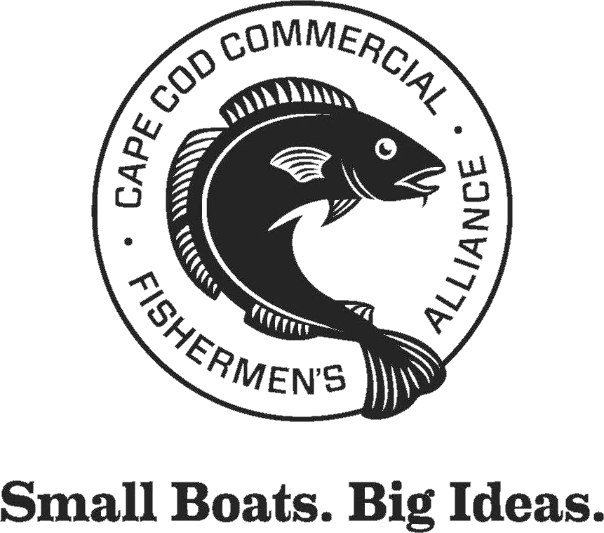{height="250px"}

[Cape Cod Commercial Fishermen's Alliance](https://capecodfishermen.org/)
:::

::: {.carousel-item .text-center}
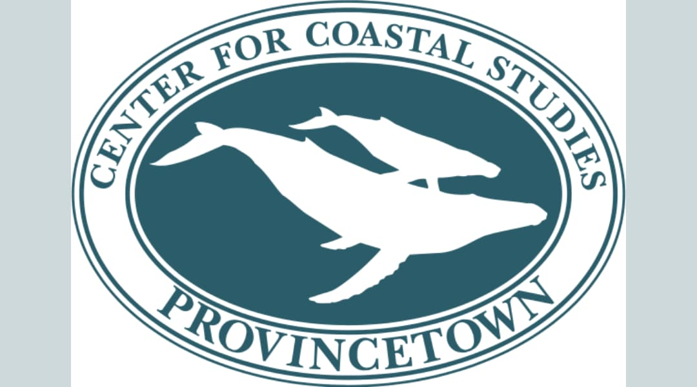{height="250px"}

[Center for Coastal Studies](https://coastalstudies.org/)
:::

::: {.carousel-item .text-center}
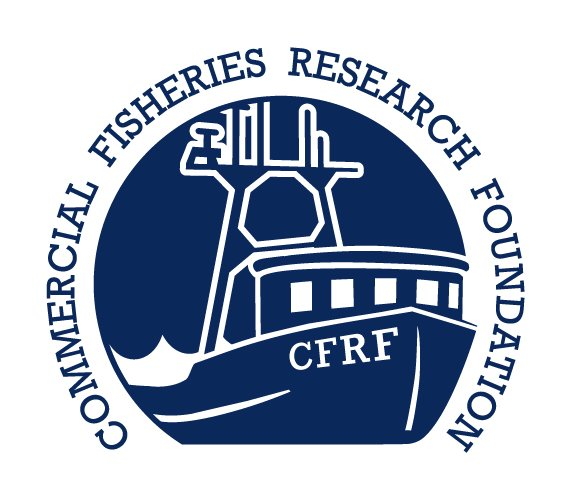{height="250px"}

[Commercial Fisheries Research Foundation](https://www.cfrfoundation.org/)
:::

::: {.carousel-item .text-center}
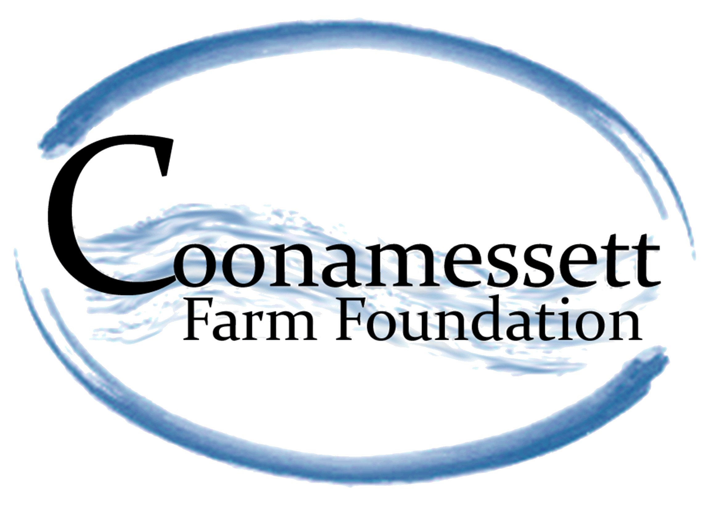{height="250px"}

[Coonamessett Farm Foundation](https://www.coonamessettfarmfoundation.org/)
:::

::: {.carousel-item .text-center}
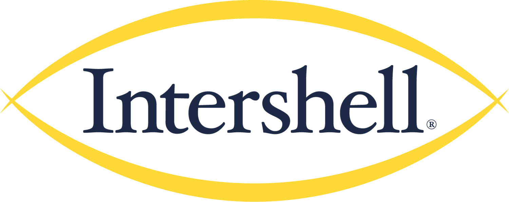{height="250px"}

[Intershell Seafood](https://intershellseafood.com/?srsltid=AfmBOor3dM7Qpk3SDGeKR-Dmn979iPNL5B8SpliYf8XMWtf6eNMZ1oVL)
:::

::: {.carousel-item .text-center}
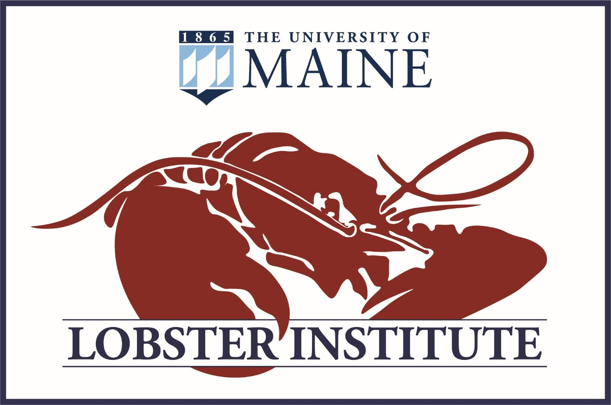{height="250px"}

[The Lobster Institute](https://umaine.edu/lobsterinstitute/)
:::

::: {.carousel-item .text-center}
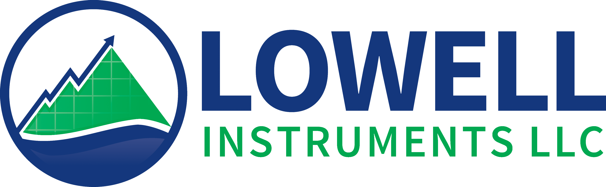{height="200px"}

[Lowell Instruments](https://lowellinstruments.com/)
:::

::: {.carousel-item .text-center}
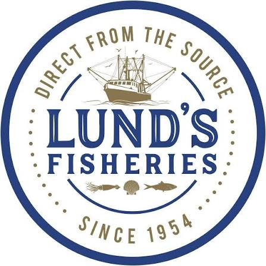{height="250px"}

[Lund's Fisheries](https://lundsfish.com/)
:::

::: {.carousel-item .text-center}
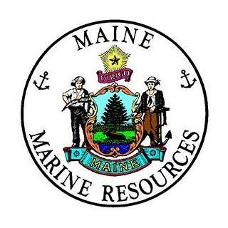{height="250px"}

[Maine Department of Marine Resources](https://www.maine.gov/dmr/home)
:::

::: {.carousel-item .text-center}
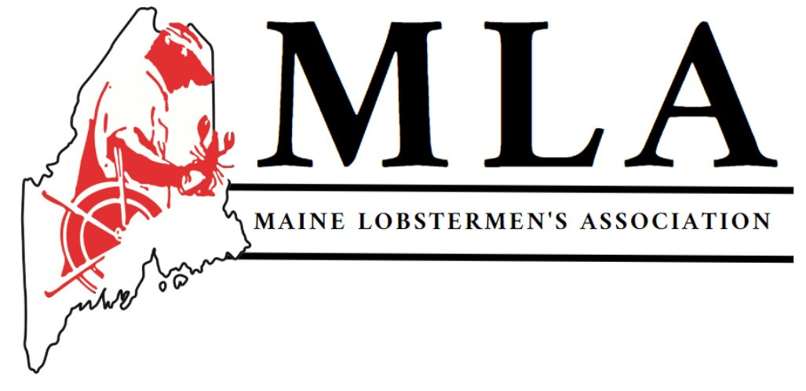{height="250px"}

[Maine Lobstermen's Association](https://www.mainelobstermen.org/)
:::

::: {.carousel-item .text-center}
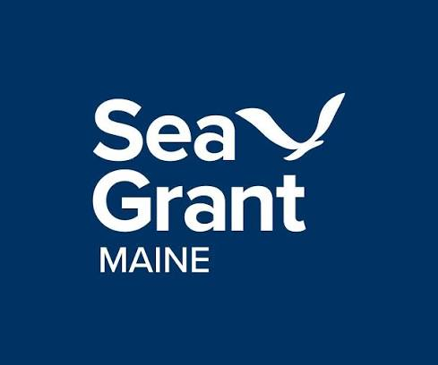{height="250px"}

[Maine Sea Grant](https://seagrant.umaine.edu/)
:::

::: {.carousel-item .text-center}
{height="250px"}

[Martha's Vineyard Fishermen's Preservation Trust](https://www.mvfishermenspreservationtrust.org/)
:::

::: {.carousel-item .text-center}
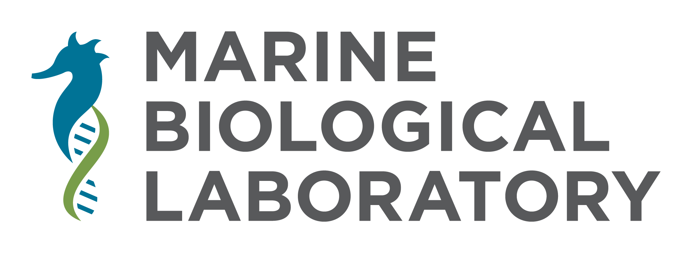{height="250px"}

[Marine Biological Laboratory](https://www.mbl.edu/)
:::

::: {.carousel-item .text-center}
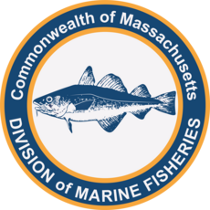{height="250px"}

[Massachusetts Division of Marine Fisheries](https://www.mass.gov/orgs/division-of-marine-fisheries)
:::

::: {.carousel-item .text-center}
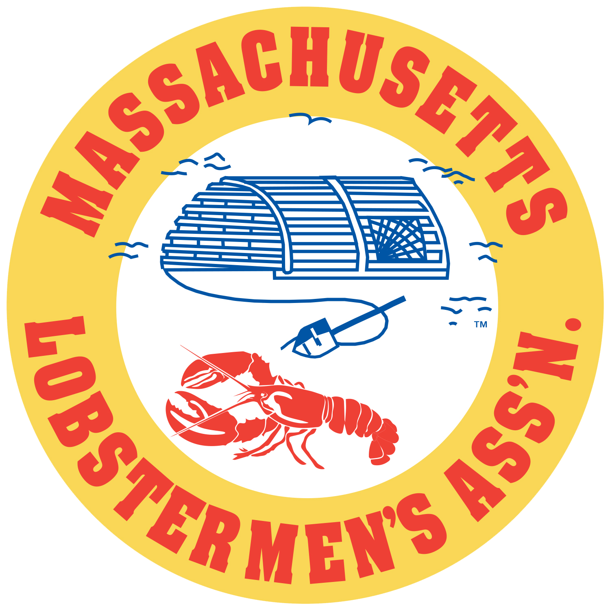{height="250px"}

[Massachusetts Lobstermen's Association](https://lobstermen.com/)
:::

::: {.carousel-item .text-center}
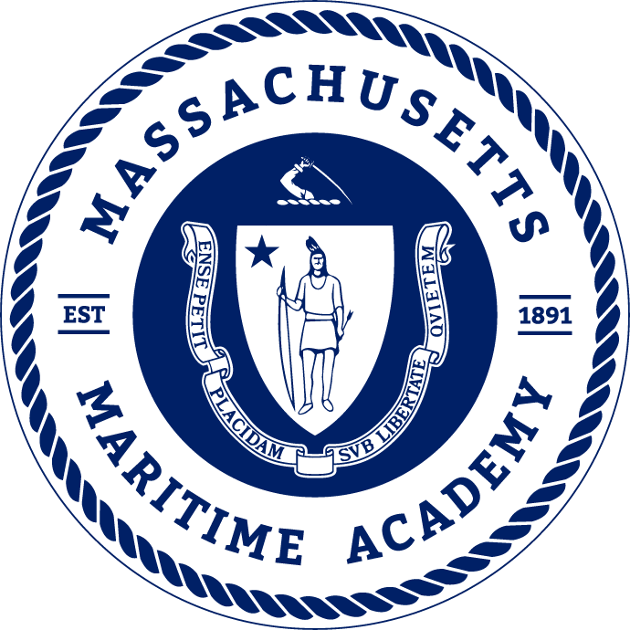{height="250px"}

[Massachusetts Maritime Academy](https://www.maritime.edu/)
:::

::: {.carousel-item .text-center}
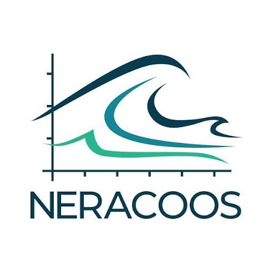{height="250px"}

[Northeastern Regional Association of Coastal Ocean Observing Systems](https://neracoos.org/)
:::

::: {.carousel-item .text-center}
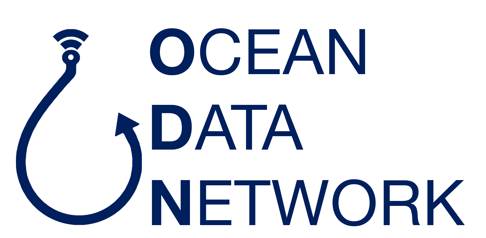{height="250px"}

[Ocean Data Network](https://oceandatanetwork.com)
:::

::: {.carousel-item .text-center}
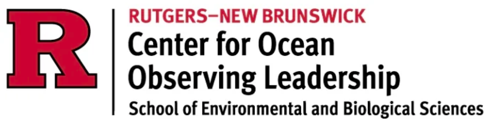{height="200px"}

[Rutgers University Center for Ocean Observing Leadership](https://rucool.marine.rutgers.edu/)
:::

::: {.carousel-item .text-center}
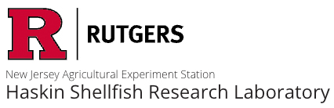{height="250px"}

[Rutgers University Haskin Shellfish Research Lab](https://hsrl.rutgers.edu/)
:::

::: {.carousel-item .text-center}
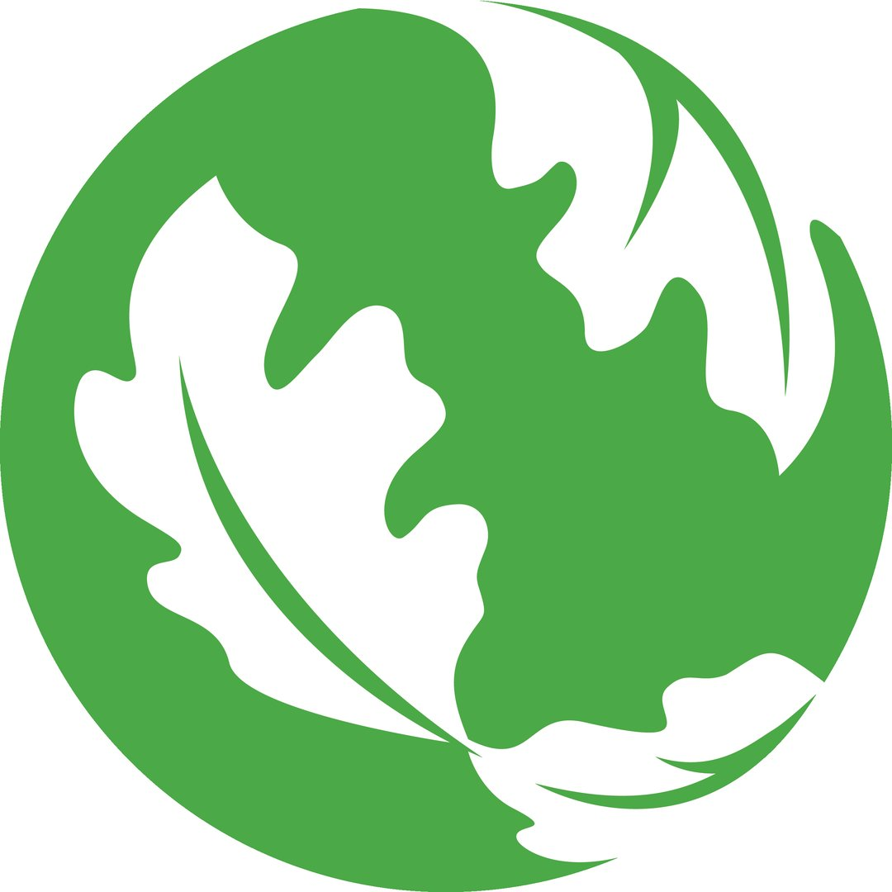{height="250px"}

[The Nature Conservancy in Massachusetts Oceans and Coasts Program](https://www.nature.org/en-us/about-us/where-we-work/united-states/massachusetts/ocean-and-coasts/)
:::

::: {.carousel-item .text-center}
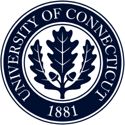{height="250px"}

[University of Connecticut Department of Marine Sciences](https://marinesciences.uconn.edu/)
:::

::: {.carousel-item .text-center}
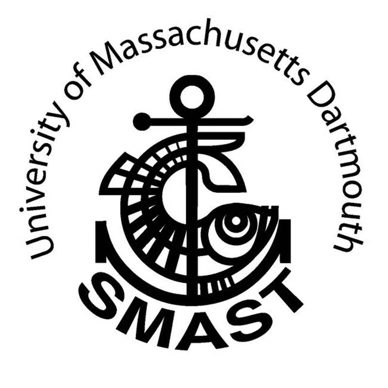{height="250px"}

[University of Massachusetts Dartmouth School for Marine Science and Technology](https://www.umassd.edu/smast/)
:::

::: {.carousel-item .text-center}
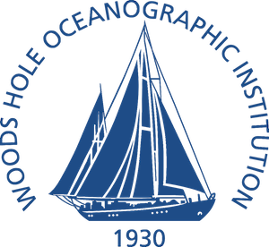{height="250px"}

[Woods Hole Oceanographic Institution](https://www.whoi.edu/)
:::

::: {.carousel-item .text-center}
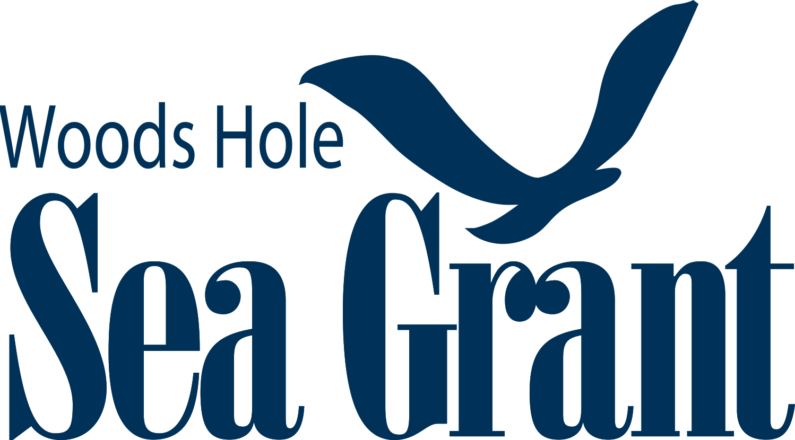{height="250px"}

[Woods Hole Sea Grant](https://seagrant.whoi.edu/)
:::

:::::::::::::::::::::

<button class="carousel-control-prev" type="button" data-bs-target="#slide-carousel" data-bs-slide="prev" style="filter: invert(100%);">
  <span class="carousel-control-prev-icon" aria-hidden="true"></span>
  <span class="visually-hidden">Previous</span>
</button>

<button class="carousel-control-next" type="button" data-bs-target="#slide-carousel" data-bs-slide="next" style="filter: invert(100%);">
  <span class="carousel-control-next-icon" aria-hidden="true"></span>
  <span class="visually-hidden">Next</span>
</button>

::::::::::::::::::::::

```{=html}
<script>
document.addEventListener("DOMContentLoaded", function() {
  const container = document.querySelector("#slide-carousel .carousel-inner");
  if (!container) return;

  // Convert elements to an array and shuffle them (Fisher-Yates)
  const items = Array.from(container.querySelectorAll(".carousel-item"));
  for (let i = items.length - 1; i > 0; i--) {
    const j = Math.floor(Math.random() * (i + 1));
    [items[i], items[j]] = [items[j], items[i]];
  }

  // Clear current active state, assign active to new 1st slide, and re-append
  items.forEach((item, index) => {
    item.classList.remove("active");
    if (index === 0) item.classList.add("active");
    container.appendChild(item);
  });
});
</script>
```

## Research Initiatives Supported

### Commercial Fisheries Research Foundation

-   [Lobster and Jonah Crab Research Fleet](https://www.cfrfoundation.org/jonah-crab-lobster-research-fleet)
- [Fishing Industry Shared Bottom Oceanographic Timeseries (FIShBOT)](https://fishbot.net/)

### Coonamessett Farm Foundation

-   [Davis Bank East Benthic Surveys](https://www.coonamessettfarmfoundation.org/clam-survey)
-   [Electronic Monitoring in the Sea Scallop Fishery](https://www.coonamessettfarmfoundation.org/electronic-monitoring)

### The Lobster Institute

-   [Navigating the New Arctic](https://umaine.edu/lobsterinstitute/nna-home-page/)

### Maine Department of Marine Resources

-   [Fishery Direct Data Program](https://www.maine.gov/dmr/science/species-information/maine-lobster/surveys/fisheries-directed-data-program)

### Massachusetts Division of Marine Fisheries

-   [Cape Cod Bay Study Fleet](https://www.mass.gov/info-details/tracking-dissolved-oxygen-with-the-cape-cod-bay-study-fleet-and-dmf)

### Northeast Fisheries Science Center

-   [Bottom Longline Survey](https://www.fisheries.noaa.gov/new-england-mid-atlantic/science-data/gulf-maine-bottom-longline-survey)
-   [Study Fleet](https://www.fisheries.noaa.gov/new-england-mid-atlantic/science-data/cooperative-research-northeast#study-fleet)
-   [Squid Squad](https://www.fisheries.noaa.gov/new-england-mid-atlantic/science-data/cooperative-research-northeast#collaborative-squid-research)

### The University of Connecticut

-   [Assessing vulnerability of the Atlantic Sea Scallop social- ecological system in the northeast waters of the US](https://samanthasiedlecki.wixsite.com/coastalbiogeodynlab/projects)
