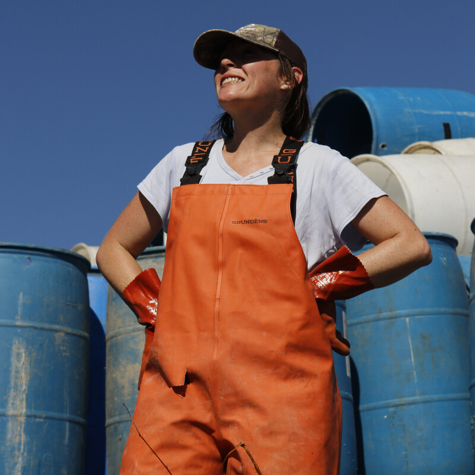
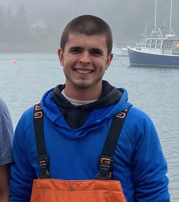

::::: {layout-ncol="2"}

### Emma Weed

Emma Weed is the Program Director at the Gulf of Maine Lobster Foundation. She grew up in Stonington, Maine in a multi-generational fishing family and recently earned a Master of Science in Program Management at Northeastern University's Roux Institute. Emma provides technical support for eMOLT partners throughout Maine.

**Contact Emma:** [](mailto:emma@gomlf.org)   [](https://www.linkedin.com/in/emma-weed-b0a979159/)

### Dr. Andrew Goode

Dr. Andrew Goode is a postdoctoral scholar at the University of Maine who previously worked as a commercial lobsterman. His research works to better understand the factors controlling lobster populations, and find ways to use this information to better anticipate and plan against climate change impacts to the resource and fishery. Andrew provides support for eMOLT partners Downeast and along the Mid-Coast

**Contact Andrew:** [](mailto:andrew.goode@maine.edu)

:::::
