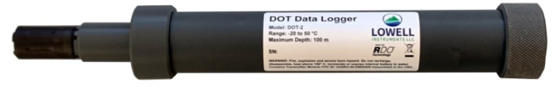
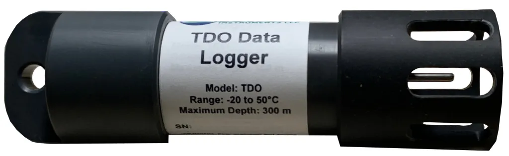
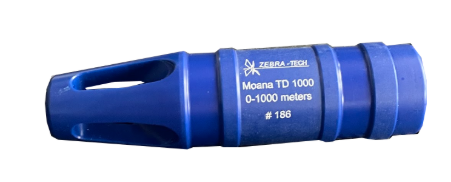

The eMOLT Program relies on two pieces of hardware to work:

1) A deckbox installed in the wheelhouse
2) A logger installed on the gear

## The Deckbox

The deckbox is a touch-screen microcomputer that handles wireless communication with the logger and with shoreside servers, provides simple data visualizations, and handles some data collection and data processing. The deckboxes used in the eMOLT Program are either purchased through Lowell Instruments or assembled by the Gulf of Maine Lobster Foundation. [Click here]() to learn more about the components of deckboxes built by the Gulf of Maine Lobster Foundation.

## The Loggers

The eMOLT Program currently deploys three types of loggers

| | Make | Model | Parameters |
|-|------|-------|-----------|
|{height="50px"}| Lowell Instruments | [DOT-2](https://lowellinstruments.com/on-deck-data-system/wireless-dissolved-oxygen-and-temperature-logger/) | Dissolved Oxygen and Temperature|
|{height="110px"}| Lowell Instruments | [TDO-1 and TDO-2](https://lowellinstruments.com/on-deck-data-system/wireless-temperature-depth-orientation-profiling-logger/) | Temperature, Depth, Orientation|
|{height="150px"}| Zebra Tech | [Moana TD-200 and TD-1000](https://www.zebra-tech.co.nz/moana-td-sensor/) | Temperature and Depth |